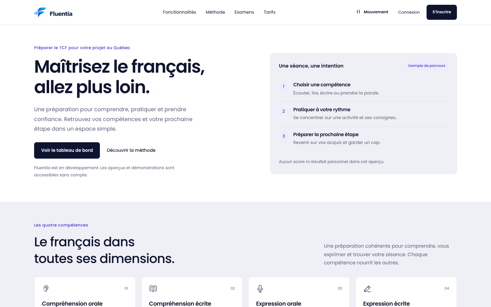
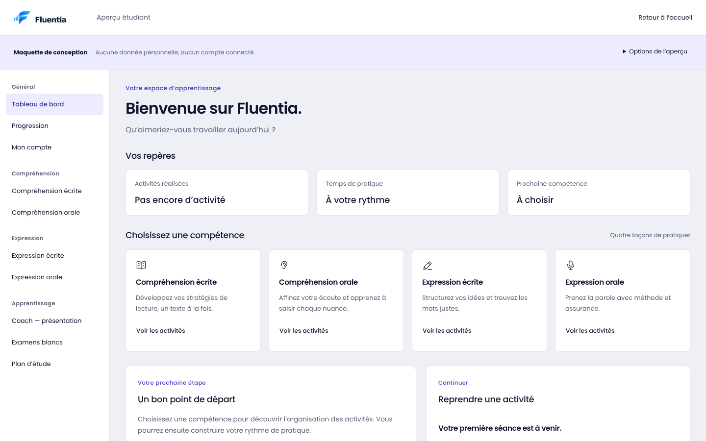
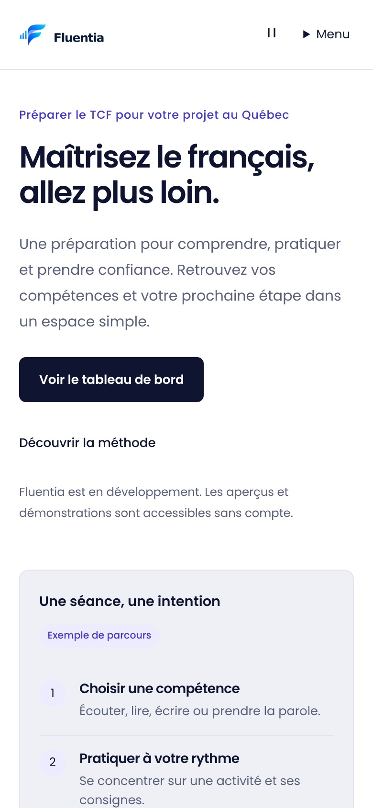
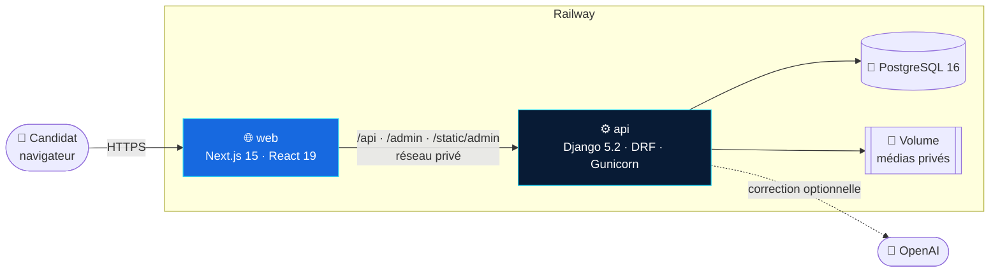
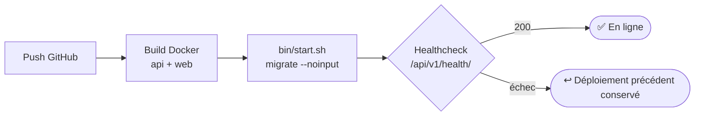

<div align="center">


<a href="https://github.com/JonathanK-N/fluentia">
  
</a>

<br/>

[](https://github.com/JonathanK-N/fluentia/actions/workflows/ci.yml)


**Plateforme SaaS de préparation au TCF Canada** · conçue par [Cognito Inc.](https://github.com/JonathanK-N)

[Fonctionnalités](#-fonctionnalités) · [Aperçu](#-aperçu) · [Architecture](#-architecture) · [Démarrage](#-démarrage-rapide) · [Déploiement](#-déploiement-railway) · [Qualité](#-qualité-et-tests) · [Équipe](#-équipe)

</div>

---

## 🌊 En bref

Fluentia accompagne les candidats au **TCF Canada** dans les quatre épreuves, de la première série d'entraînement à l'examen blanc. Le produit associe des séries originales, un moteur d'examen fiable (sauvegarde des réponses, chronométrage, barème pondéré), une **correction de l'expression écrite par IA diffusée en direct** et une banque pédagogique gérée par l'équipe éditoriale.

> [!NOTE]
> Fluentia est en développement actif. Les scores produits automatiquement sont des **estimations pédagogiques** : ils ne remplacent pas un résultat officiel du TCF.

<table>
<tr>
<td width="50%" valign="top">

### 🎧 Compréhension orale
Lecture audio continue, toutes les questions accessibles, médias privés servis uniquement aux candidats inscrits à la tentative.

### 📖 Compréhension écrite
QCM de **39 questions / 699 points** au barème pondéré, documents en image, bilan de séance détaillé et bouton *Refaire la série*.

</td>
<td width="50%" valign="top">

### ✍️ Expression écrite
Studio de rédaction (trois tâches, compteur de mots, minuteur, brouillon local) et **correction IA en streaming** avec niveau estimé, NCLC et proposition de texte modèle.

### 🎙️ Expression orale
Studio oral : préparation, enregistrement local, niveau du micro, prises multiples. Aucun audio n'est envoyé sans action explicite.

</td>
</tr>
</table>

## ✨ Fonctionnalités

| | Module | Ce qui est livré |
|---|---|---|
| 🧭 | **Espace étudiant** | Tableau de bord, accès aux quatre compétences, progression, plan d'étude, compte et support |
| ⏱️ | **Examens blancs** | Simulations complètes chronométrées, mode plein écran, une question à la fois |
| ✅ | **Correction en direct** | Verdict immédiat du choix envoyé (sans révéler la bonne réponse), désactivable pour les conditions d'examen |
| 🤖 | **Correction IA** | Fournisseur interchangeable (`demo` hors ligne ou `openai`), quota quotidien compté en base |
| 📥 | **Import Excel** | Séries des quatre épreuves importées depuis un modèle `.xlsx` + archive `.zip` d'audios et d'images (jusqu'à 250 Mo) |
| 🗂️ | **Banque pédagogique** | Cycle brouillon → relecture → approuvé → publié, historique des versions, retrait et remise en ligne |
| 🔐 | **Comptes** | Connexion par courriel, vérification d'adresse, sessions même origine, CSRF strict, limitation de débit |
| ⭐ | **Premium** | Abonnement avec date de fin, attribué depuis l'administration (paiement en ligne à venir) |
| 🛠️ | **Administration** | Django Admin servi sur la même origine que le site (`/admin`) |
| 📱 | **PWA & accessibilité** | Manifest, icônes officielles, navigation clavier, zoom 200 %, contrastes AA vérifiés |

## 📸 Aperçu

<div align="center">



<br/><br/>

<table>
<tr>
<td width="68%"></td>
<td width="32%"></td>
</tr>
<tr>
<td align="center"><sub>Tableau de bord étudiant</sub></td>
<td align="center"><sub>Expérience mobile</sub></td>
</tr>
</table>

</div>

## 🧱 Architecture



Le navigateur ne parle qu'au service **web** : Next.js réécrit `/api/v1/*`, `/admin` et `/static/admin` vers l'API sur le réseau privé. L'API n'a pas de domaine public, et cookies de session et CSRF restent sur une seule origine.

<details>
<summary><b>📂 Structure du dépôt</b></summary>

```text
fluentia/
├── apps/
│   ├── web/                    Next.js + TypeScript (App Router)
│   │   ├── app/                Routes : accueil, /etudiant, /edition, /design-system
│   │   ├── features/           Écrans métier (landing, student, design-system)
│   │   ├── components/         Coque applicative, UI, navigation, animations
│   │   ├── lib/                Client API, session, plein écran, sons
│   │   └── tests/              Vitest + Playwright (e2e, accessibilité, zoom)
│   └── api/                    Django REST Framework
│       ├── accounts/           Comptes, sessions, vérification, Premium
│       ├── exams/              Moteur d'examen, tentatives, barème pondéré
│       ├── pedagogy/           Banque, séries, import Excel, médias, correction IA
│       ├── health/             Sonde de santé publique
│       ├── config/             Paramètres, routes, WSGI
│       ├── gunicorn.conf.py    Serveur de production
│       └── bin/start.sh        Migrations puis démarrage
├── design/ux-ui-02/            Prototypes et références de conception
├── docs/                       Spécifications, décisions, rapports, guide Railway
├── scripts/                    Jeux de données e2e, vérifications, démo locale
├── docker-compose.yml          Pile locale complète
└── .env.railway.example        Variables de production (modèle)
```

</details>

<details>
<summary><b>🔌 Aperçu de l'API</b> — documentation interactive sur <code>/api/schema/swagger-ui/</code></summary>

| Domaine | Points d'entrée principaux |
|---|---|
| Santé | `GET /api/v1/health/` |
| Authentification | `auth/csrf/` · `auth/register/` · `auth/login/` · `auth/logout/` · `auth/profile/` · `auth/verify/` |
| Examens | `exams/` · `exams/{id}/attempts/` · `attempts/{id}/answers/` · `attempts/{id}/submit/` · `attempts/{id}/results/` |
| Médias | `attempts/{id}/questions/{qid}/audio/` · `…/image/` |
| Rédaction | `tasks/{skill}/` · `tasks/writing/subjects/{id}/correction/` · `…/corrections/{id}/stream/` · `…/model-answer/` |
| Banque éditoriale | `bank/` · `bank/series/import/` · `bank/series/{id}/{action}/` · `bank/{id}/transition/` · `bank/{id}/history/` |
| Progression | `progress/` |

</details>

## 🚀 Démarrage rapide

**Prérequis :** Docker et Docker Compose, ou Python 3.12 + Node.js 22.12+.

### Avec Docker (pile complète)

```bash
git clone https://github.com/JonathanK-N/fluentia.git && cd fluentia
cp .env.example .env
docker compose build
docker compose up -d db
docker compose run --rm api python manage.py migrate --noinput
docker compose run --rm api python manage.py createsuperuser
docker compose up
```

| Service | URL |
|---|---|
| 🌐 Site | http://localhost:3000 |
| 🩺 Santé de l'API | http://localhost:8000/api/v1/health/ |
| 📘 Swagger | http://localhost:8000/api/schema/swagger-ui/ |
| 🛠️ Administration | http://localhost:3000/admin |

### Sans Docker

<details>
<summary>Backend (Django)</summary>

```bash
cd apps/api
python -m venv .venv && source .venv/bin/activate   # Windows : .venv\Scripts\activate
pip install -r requirements.txt
export DJANGO_DEBUG=1                               # SQLite locale par défaut
python manage.py migrate
python manage.py seed_original_tcf                  # séries de démonstration
python manage.py seed_original_bank
python manage.py runserver 127.0.0.1:8000
```

</details>

<details>
<summary>Frontend (Next.js)</summary>

```bash
cd apps/web
npm ci
npm run dev        # http://localhost:3000 — /api est réécrit vers API_ORIGIN (défaut : http://127.0.0.1:8000)
```

</details>

Démo Windows complète (PostgreSQL + API + site) : [`scripts/demarrer-demo-locale.ps1`](scripts/demarrer-demo-locale.ps1) · procédure détaillée : [docs/EXPERIENCE_V2.md](docs/EXPERIENCE_V2.md#démarrage-local).

## ⚙️ Configuration

| Variable | Service | Rôle |
|---|---|---|
| `DATABASE_URL` | api | Connexion PostgreSQL (SQLite si absente) |
| `DJANGO_SECRET_KEY` | api | Obligatoire hors mode debug |
| `DJANGO_DEBUG` | api | `1` en local, `0` en production |
| `DJANGO_ALLOWED_HOSTS` | api | Hôtes acceptés (domaines Railway ajoutés automatiquement) |
| `PUBLIC_WEB_ORIGIN` | api | Origine publique du site : liens de courriel et CSRF |
| `PRIVATE_MEDIA_ROOT` | api | Dossier des audios et images privés (volume persistant) |
| `WRITING_CORRECTOR` | api | `demo` (hors ligne) ou `openai` |
| `OPENAI_API_KEY` · `OPENAI_MODEL` | api | Requis si `WRITING_CORRECTOR=openai` |
| `EMAIL_HOST` · `EMAIL_*` | api | SMTP du courriel de vérification |
| `API_ORIGIN` | web | Adresse interne de l'API, **figée au build** |

Liste complète et commentée : [`.env.example`](.env.example) (local) · [`.env.railway.example`](.env.railway.example) (production).

## 🚂 Déploiement Railway



Trois services (**web**, **api**, **Postgres**) et un volume pour les médias privés. Les Dockerfiles gèrent le port Railway, les fichiers statiques (WhiteNoise), les migrations et Gunicorn `gthread` adapté à la correction en streaming.

👉 **Guide pas à pas, variables, vérifications et dépannage : [docs/RAILWAY.md](docs/RAILWAY.md)**

## 🧪 Qualité et tests

| Couche | Outils | Couverture |
|---|---|---|
| Backend | `manage.py test` | 135 tests : comptes, moteur d'examen, concurrence PostgreSQL, import, correction IA |
| Frontend | Vitest + Testing Library | Composants, accueil, tableau de bord |
| Navigateurs | Playwright | Chromium, Firefox, WebKit, zoom 200 %, axe WCAG 2.1 AA |
| Parcours | Playwright sur API réelle | Inscription → séries → résultats, sur PostgreSQL |
| Conteneurs | GitHub Actions | Build et démarrage des images, Docker Compose de bout en bout |
| Sécurité | `pip-audit` · `npm audit` | Dépendances Python et Node |

```bash
# Backend
cd apps/api && DJANGO_DEBUG=1 python manage.py test

# Frontend
cd apps/web && npm run lint && npm run typecheck && npm test && npm run build
npx playwright install chromium && npm run test:e2e
```

## 🛡️ Sécurité

- Sessions **HttpOnly**, `Secure` et `SameSite=Lax` ; CSRF exigé, y compris avant l'authentification.
- API privée derrière le service web ; réponses personnelles en `Cache-Control: private, no-store`.
- Médias servis uniquement au propriétaire de la tentative, avec contrôle d'intégrité (taille et SHA-256).
- Mots de passe de 12 caractères minimum, limitation de débit sur l'authentification et l'édition.
- Correction IA désactivée par défaut (`demo`) : aucun texte ne quitte le serveur sans configuration explicite.

Politique complète : [docs/SECURITY.md](docs/SECURITY.md).

## 🗺️ Feuille de route

- [x] Fondations frontend, design system et identité visuelle
- [x] Moteur d'examen, comptes et parcours étudiant
- [x] Banque pédagogique, médias privés, compréhension orale, simulations
- [x] Import Excel des séries et correction IA de la rédaction
- [x] Préparation du déploiement Railway
- [ ] Paiement en ligne (Stripe) et gestion des abonnements
- [ ] Coach personnalisé et répétition espacée
- [ ] Évaluation automatisée de l'expression orale
- [ ] Espace établissements (classes, enseignants, licences)

Détails : [docs/ROADMAP.md](docs/ROADMAP.md).

## 📚 Documentation

| | Document |
|---|---|
| 🧱 | [Architecture](docs/ARCHITECTURE.md) |
| 🎓 | [Spécifications produit](docs/PRODUCT.md) |
| 🎨 | [Design system](docs/DESIGN_SYSTEM.md) · [Marque](docs/BRAND.md) |
| 🔌 | [API](docs/API.md) |
| 🛡️ | [Sécurité](docs/SECURITY.md) · [Accessibilité](docs/ACCESSIBILITY.md) |
| 🚂 | [Déploiement Railway](docs/RAILWAY.md) · [Exploitation](docs/DEPLOYMENT.md) |
| 🌿 | [Stratégie de branches](docs/BRANCHING_STRATEGY.md) · [Contribuer](CONTRIBUTING.md) |
| 🔍 | [Audit de `main`](docs/AUDIT_MAIN.md) |
| 📝 | [Historique](CHANGELOG.md) · [Index complet](docs/README.md) |

## 🤝 Contribuer

1. Partir de `dev` et créer une branche descriptive (`feature/…`, `fix/…`).
2. Lancer lint, typage, tests et build avant d'ouvrir la PR.
3. Ouvrir une PR vers `dev` ; `main` ne reçoit que des versions validées.

Règles complètes : [CONTRIBUTING.md](CONTRIBUTING.md).

## 👥 Équipe

<table>
<tr>
<td align="center" width="220">
<a href="https://github.com/JonathanK-N"></a><br/>
<b>Jonathan Kakesa</b><br/>
<sub>Fondateur · Cognito Inc.<br/>Produit, architecture, responsabilité éditoriale</sub>
</td>
<td align="center" width="220">
<br/>
<b>Mamadou Barry</b><br/>
<sub>Co-auteur et contributeur<br/>Expérience v2, espace étudiant</sub>
</td>
</tr>
</table>

<div align="center">

---


**Fluentia** · un produit [Cognito Inc.](https://github.com/JonathanK-N) · Sherbrooke, Québec

<sub>© 2026 Cognito Inc. Tous droits réservés.</sub>


</div>
