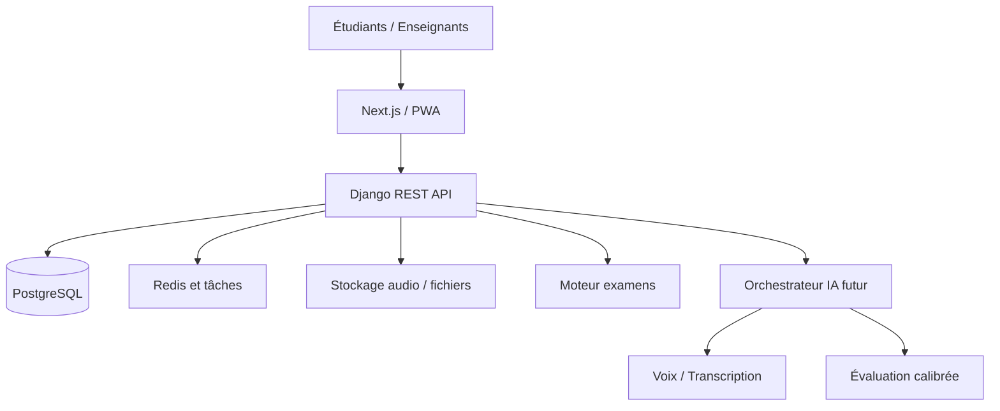

# 🧱 Architecture — Fluentia

**Responsable : Jonathan Kakesa** · Version 0.1

## Décisions structurantes

- Monolithe Django organisé par domaines métier, service IA séparé lorsque nécessaire.
- API versionnée et contrats documentés via OpenAPI.
- PostgreSQL comme source de vérité, Redis pour le cache et les jobs.
- Accès serveur obligatoire pour les barèmes, réponses correctes, délais et droits.
- Sessions d'examen immuables par version et sauvegardées régulièrement.
- Isolation stricte par organisation pour l'espace écoles.

## Décomposition cible

`accounts`, `organizations`, `catalog`, `exams`, `attempts`, `learning`, `evaluations`, `billing`, `notifications`, `support`, `audit`.

> [!NOTE]
> Le diagramme représente l'architecture cible. Seul un premier frontend et un endpoint de santé sont réalisés dans ce lot.
