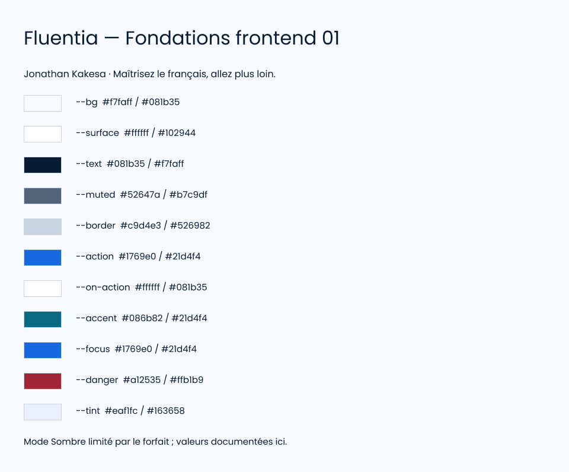
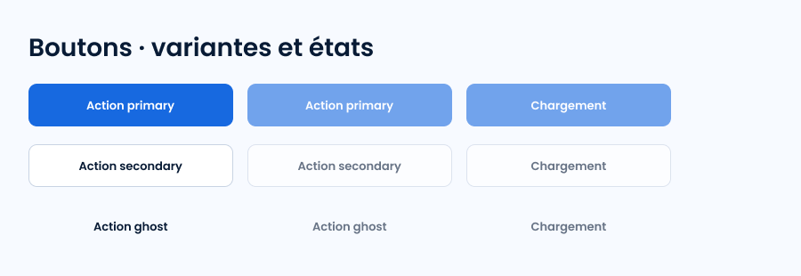

# Conception Figma

Responsable : Jonathan Kakesa.

[Fichier Fluentia — Fondations frontend 01](https://www.figma.com/design/SIjNphVU1NHimwwImszGbE).

Réalisé : palette de primitives, 11 tokens sémantiques, 3 dimensions, 3 styles Poppins, spécimen et composant Button à 18 variantes (primary/secondary/ghost × default/hover/focus/active/disabled/loading). Les deux planches ont été inspectées visuellement. Les remplissages et textes sont liés aux variables ; l’intégration complète des dimensions et de Code Connect reste à compléter.

Le forfait Starter a refusé le second mode de variables : les valeurs sombres sont indiquées dans le spécimen. Les maquettes desktop/tablette/mobile et la bibliothèque complète de composants Figma ne sont pas encore créées. Le catalogue codé est plus complet que cette première base Figma. Les identifiants sont conservés dans figma-state.json.

