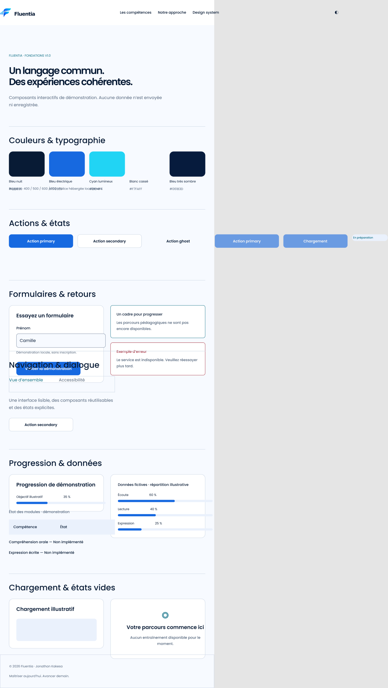

# Conception Figma — état réel

Responsable : Jonathan Kakesa. 24 octobre 2026. **Non validé : défauts visuels et quota Starter atteint.**

[Fichier Fluentia](https://www.figma.com/design/SIjNphVU1NHimwwImszGbE) · [revue des composants](https://www.figma.com/design/SIjNphVU1NHimwwImszGbE?node-id=12-819).

## Fondations et correspondances

Les primitives existantes sont conservées. Douze tokens sémantiques par thème comprennent désormais `control-border`. Le sombre utilise une collection séparée avec un seul mode, pour respecter Starter ; aucun second mode n’est revendiqué. Les dimensions liées aux composants correspondent aux variables CSS ; huit styles Poppins sont disponibles. Le CSS reste la référence. La syntaxe WEB des primitives `var(--primitive-...)` doit encore être alignée sur les variables réellement définies : ces alias primitifs n’existent pas dans le CSS livré. Les scopes de couleur, les ombres et les représentations du focus restent à auditer avant validation.

| React | Ensemble Figma | Variantes |
|---|---|---:|
| Button clair | 3:38 | 18 |
| Button sombre | 12:11 | 18 |
| Field | 8:21 | 10 |
| Card | 8:66 | 4 |
| Badge | 8:77 | 2 |
| Alert | 8:84 | 4 |
| Notification | 8:97 | 4 |
| Progress | 8:110 | 6 |
| Skeleton | 8:135 | 2 |
| EmptyState | 8:138 | 2 |
| DataTable | 8:149 | 4 |
| BarChart | 8:168 | 2 |
| Tabs | 8:201 | 6 |
| Dialog | 8:230 | 4 |
| Header et PNG officiel | 12:54 | 6 |

Pour ouvrir un ensemble : ajouter `?node-id=8-21` au lien du fichier, en remplaçant l’identifiant. Les primitives sont dans `apps/web/components/ui/primitives.tsx`, les autres UI dans `dialog.tsx`, `tabs.tsx` et `notification.tsx`. Header est dans `components/navigation/header.tsx`, Logo dans `components/branding/logo.tsx`. Ce tableau est une correspondance manuelle, **pas une publication Code Connect**.

Button couvre trois variantes × six états. Field : default/hover/focus/error/disabled ; Card : default/hover ; Alert : info/error ; Notification : visible/empty ; Progress : 0/35/100 ; DataTable : populated/empty ; Tabs : overview/accessibility/focus ; Dialog : open/closed ; Header : desktop/mobile fermé/mobile ouvert. Les familles autres que Button portent l’axe Theme. Le hover de Card représente l’usage `.competency` sur grand écran sans mouvement réduit ; une carte générique n’est pas un bouton. Skeleton reste un spécimen statique, son animation est gérée en CSS.

## Six maquettes éditables créées

| Format | Clair | Sombre |
|---|---|---|
| 375 px | [12:83](https://www.figma.com/design/SIjNphVU1NHimwwImszGbE?node-id=12-83) | [12:451](https://www.figma.com/design/SIjNphVU1NHimwwImszGbE?node-id=12-451) |
| 768 px | [12:205](https://www.figma.com/design/SIjNphVU1NHimwwImszGbE?node-id=12-205) | [12:573](https://www.figma.com/design/SIjNphVU1NHimwwImszGbE?node-id=12-573) |
| 1440 px | [12:328](https://www.figma.com/design/SIjNphVU1NHimwwImszGbE?node-id=12-328) | [12:696](https://www.figma.com/design/SIjNphVU1NHimwwImszGbE?node-id=12-696) |

Les retours de création attestent 18 instances et 56 ou 57 textes Poppins par maquette ; leur seule image est le logo officiel. Aucun écran complet aplati n’a servi de livrable. Les deux PNG horizontaux ont été importés directement ; le hash sombre correspond à celui de la capture du frontend réel.

## Échec visuel et blocages

La capture de la maquette claire 768 px a été inspectée : **échec**. Les objets débordant du cadre portent la largeur exportée à 1390 px. Navigation et actions dépassent ; des champs/barres débordent et des sections se chevauchent. « Action primary » et certains contenus ne reproduisent pas exactement React. Les autres nouvelles maquettes et la nouvelle planche n’ont pas reçu leur revue visuelle.

Figma renvoie : « You've reached the Figma MCP tool call limit on the Starter plan ». La limite bloque aussi correction et inspection. Les [scripts](../scripts/README.md) et identifiants sont conservés. Le correctif préparé n’est pas appliqué au canevas. La capture temporaire `9:11` reste à nettoyer après correction.

Code Connect a explicitement refusé l’accès : siège Dev/Full sur Organization/Enterprise requis. Le skill Code Connect chargé impose également ce forfait avant publication. Aucune activation payante ni publication n’a eu lieu ; la correspondance manuelle reste disponible.

État : [fondations](figma-foundations-state.json), [composants](figma-components-state.json), [compositions](figma-layouts-state.json), [synthèse](figma-state.json). Les identifiants prouvent la création, sans prouver l’absence de défaut.
