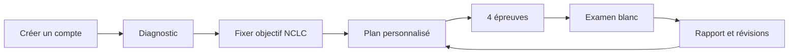

# 🎓 Spécifications fonctionnelles

**Propriétaire du produit : Jonathan Kakesa**

| Module | Fonctionnalité cible | Vérification attendue |
|---|---|---|
| 01 | Comptes et sessions | Connexion / récupération / MFA |
| 02 | Diagnostic | Profil de compétences initial |
| 03 | Compréhension orale | Questions audio et chronométrage |
| 04 | Compréhension écrite | Textes, QCM, explications |
| 05 | Expression écrite | Trois tâches et évaluations structurées |
| 06 | Expression orale | Trois tâches, audio temps réel |
| 07 | Examens blancs | Épreuve complète et reprise contrôlée |
| 08 | Coaching personnalisé | Explications contextualisées |
| 09 | Adaptation | Répétition espacée, points faibles |
| 10 | Résultats | Historique et progression |
| 11 | Motivation | Objectifs, badges facultatifs |
| 12 | Paiement | Stripe, droits et quotas |
| 13 | Établissements | Classes, enseignants et licences |
| 14 | CMS | Gestion et validation du contenu |
| 15 | Notifications | Consentement et préférences |
| 16 | Support / conformité | Export et suppression des données |

## Cadre pédagogique

Les barèmes CECRL/TCF/NCLC seront versionnés et confirmés avec les références officielles. Les scores produits automatiquement demeureront des **estimations pédagogiques**. Contenus sous licence ou originaux seulement.
