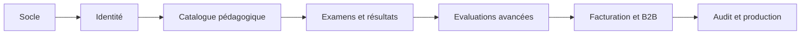

# 🗺️ Backlog — Fluentia

**Responsable : Jonathan Kakesa**

## Fondations
- [x] Source frontend de la vitrine
- [x] Source API et health check
- [x] Configuration Docker et documentation
- [ ] Vérification des builds dans CI GitHub
- [ ] Vérification en environnement staging

## Fonctionnel
- [ ] Inscription, comptes et rôles
- [ ] Schéma SQL/migrations et banque pédagogique
- [ ] 4 épreuves et examens chronométrés
- [ ] Sauvegarde/reprise des réponses
- [ ] Scores et conversion versionnée
- [ ] Correction écrite calibrée
- [ ] Simulation orale temps réel
- [ ] Coach et moteur adaptatif
- [ ] Stripe, factures et quotas
- [ ] Enseignants, classes et établissements
- [ ] Administration et modération

## Lancement
- [ ] Tests E2E, charge, accessibilité, sécurité
- [ ] Évaluation pédagogique par humains
- [ ] Mise en conformité et conditions d'utilisation
- [ ] GO explicite pour la production
