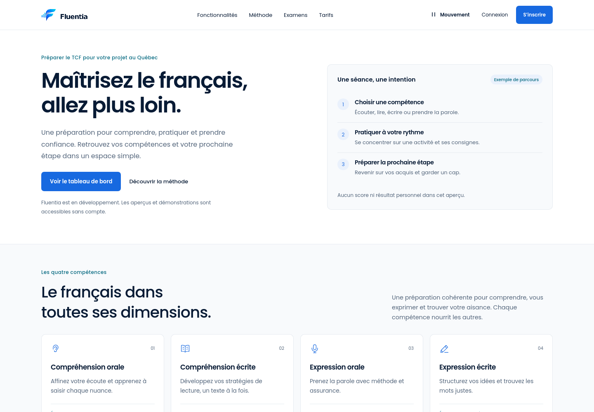
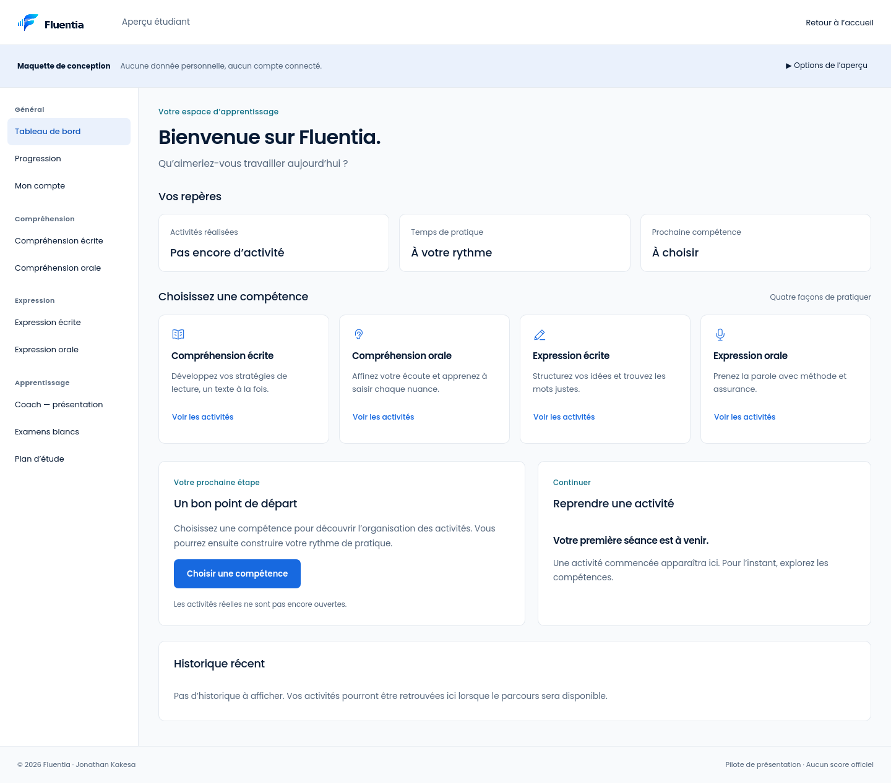

# Revue des deux pilotes Fluentia v3

Responsable et propriétaire : Jonathan Kakesa. 24 octobre 2026.

## Décision proposée

**GO pour présentation et retour visuel du client. NO-GO pour généralisation, fusion ou déploiement sans décision explicite.** Les deux pilotes sont implémentés, inspectés et testés. La réussite technique ne vaut pas approbation de leur direction graphique. La PR reste en brouillon vers dev.

## Périmètre réel

Accueil clair sur `/` et tableau de bord de conception sur `/apercu/etudiant`, sans compte connecté. Hero statique, cartes compactes, Poppins et PNG officiels ; petite sphère limitée à Voice, sans boucle permanente. Le dashboard propose un premier accès vide, un exemple rempli explicitement fictif et une indisponibilité simulée. Compétences, recommandations, reprise et historique sont organisés autour d’actions compréhensibles. Les destinations expliquent leur disponibilité réelle.

FAQ, conseil local, sept états Voice, pause, réduction du mouvement et composants existants sont conservés. Le catalogue garde ses thèmes ; les pilotes restent clairs même sous préférence système sombre. Les tokens sont limités à `.human-pilot`. Les 62 références historiques, examens simulés, espaces enseignants et administration ne sont pas refondus. Aucun service métier, authentification, paiement, capture micro ou IA distante n’est ajouté.

Documents : [audit préalable et référence ergonomique](HUMAN_CENTERED_UX.md), [direction v3](DESIGN_DIRECTION_V3.md), [tokens](DESIGN_TOKENS.md), [dashboard](DASHBOARD_REDESIGN.md), [accueil](LANDING_REDESIGN.md), [backlog Figma](FIGMA_SYNC_BACKLOG.md).

## SHA et contrôles exécutés

| Référence | SHA / lien | État vérifié |
|---|---|---|
| Base dev après fusions autorisées des PR #1 et #2 | `2e1ed545540e8ea5fb0c540475ce7e146fcf315f` | Base de la branche temporaire |
| Code source de cette recette et des captures | `f3da6299d176c47d6c52f82d7d2499497f9544b4` | Pilotes v3 corrigés |
| Quality push | [40137579875](https://github.com/JonathanK-N/fluentia/actions/runs/40137579875) | web, API et Docker réussis |
| Quality PR | [40137582611](https://github.com/JonathanK-N/fluentia/actions/runs/40137582611) | web, API et Docker réussis |
| Références UX/UI historiques | [40137582618](https://github.com/JonathanK-N/fluentia/actions/runs/40137582618) | 58 tests réussis, 2 exclusions de zoom |
| PR de livraison | [#3, branche frontend/mission-02-landing](https://github.com/JonathanK-N/fluentia/pull/3) | Brouillon vers dev ; aucune fusion |
| main et tests | `6fe83c281d9b2d94499a0208f8bd4ef3251edc5a` | Inchangés par ce lot |

Ce rapport référence le **SHA du code mesuré**, sans lui substituer le commit documentaire qui ajoute les preuves. Le HEAD documentaire et ses contrôles sont identifiés dans la PR. Les résultats au SHA `d8abfa06e3403d7069d26656b77c8c31feff4ab9` restent archivés dans [frontend-02.json](evidence/frontend-02.json) ; ils ne sont pas la validation de v3.

## Recette technique

En CI Ubuntu, Node 22, build Next de production. Chaque Quality ci-dessus exécute la même recette :

| Contrôle | Résultat réel et portée |
|---|---|
| Installation / audit npm | npm ci et audit réussis ; zéro vulnérabilité signalée par cet audit |
| Lint / TypeScript / build | Réussis ; aucune nouvelle dépendance ni modification du lockfile |
| Tests de composants | 12 réussis dans 3 fichiers, états et focus compris |
| Navigateurs | **61 réussis, 2 exclus**, zéro échec et zéro flaky dans l’artefact source |
| Responsive | Accueil/catalogue et dashboard à 320, 375, 390, 768, 1024, 1440, 1920 px sur Chromium, Firefox et WebKit ; absence de débordement global et de titres/commandes tronqués dans les scénarios contrôlés |
| Tailles intermédiaires | Géométrie publique à 320/600/900/1280/1920 px ; cartes sans intersection |
| Contrastes / thèmes | Axe sur les pages et états contrôlés ; catalogue clair/sombre, pilotes clairs sous préférence sombre ; dix paires de contraste pilote calculées |
| Clavier | Lien d’évitement, menu mobile et Échap, dialogues et retour du focus, FAQ, réessai options ouvertes/fermées, région d’historique focalisable |
| États | Premier accès, rempli fictif, indisponible/réessai et dialogues ; aucune capture micro ou média lancé |
| Mouvement | Préférence réduite à chaud, pause manuelle, contenu conservé et garde hors écran ; réaction Voice vérifiée avec sphère effectivement visible |
| Sans JavaScript | Lecture de l’accueil et FAQ native réussies ; aucune fonctionnalité métier déduite de ce test |
| Zoom réel | Chromium 200 %, largeur 1440 → 720 CSS px ; accueil, catalogue et dashboard contrôlés. Firefox/WebKit exclus car la recette utilise une extension Chromium |
| Docker | Image frontend construite, conteneur démarré, réponses de `/`, `/design-system`, `/apercu/etudiant`, manifest et PNG 192 contrôlées ; conteneur de test supprimé ensuite |
| API existante | Django check sans anomalie, 1 test réussi ; aucune API supplémentaire |
| Références historiques | Recette séparée des 62 références : responsive, accessibilité, huit parcours simulés et zoom Chromium ; 58 réussites / 2 exclusions |

Les dépendances de développement locales Windows sont incomplètes : aucune réussite locale de lint, TypeScript ou build n’est revendiquée. L’aperçu Next de développement et ses interactions ont été inspectés localement ; les résultats reproductibles ci-dessus proviennent de la CI de production.

## Corrections issues des cycles

Le premier cycle v3 [40136190302](https://github.com/JonathanK-N/fluentia/actions/runs/40136190302) a produit 55 réussites / 6 échecs / 2 exclusions : lien actif à 4,47:1. Son texte utilise maintenant `#1358BD` sur `#EAF1FC`, soit **5,853:1**. Le cycle [40136744840](https://github.com/JonathanK-N/fluentia/actions/runs/40136744840) a produit 58 réussites / 3 échecs / 2 exclusions : le sélecteur d’erreur rencontrait aussi l’annonceur Next.js, corrigé en ciblant le main du pilote.

L’inspection locale a révélé la perte du focus après Réessayer lorsque les options étaient refermées : le focus retourne désormais au résumé visible. L’inspection Firefox a révélé le symbole du coach non chargé hors écran : le PNG officiel est chargé immédiatement, avec vérification de décodage avant capture.

Les cycles [40137179226](https://github.com/JonathanK-N/fluentia/actions/runs/40137179226) et [40137325440](https://github.com/JonathanK-N/fluentia/actions/runs/40137325440) ont produit 60 réussites / 1 échec / 2 exclusions. La trace WebKit montre la sphère hors écran après le clic automatisé ; sa suspension est attendue. Le test la place maintenant dans le viewport avant de vérifier sa réaction, sans désactiver la garde. Les deux Quality au SHA source ci-dessus sont ensuite réussies.

## Captures réellement inspectées

Captures issues du build de production du SHA source, sans retouche d’interface :

| Format / moteur | Accueil complet | Dashboard premier accès |
|---|---|---|
| Mobile 375 — Chromium | [capture](images/human-centered/accueil-chromium-375.png) | [capture](images/human-centered/etudiant-chromium-375.png) |
| Tablette 768 — Firefox | [capture](images/human-centered/accueil-firefox-768.png) | [capture](images/human-centered/etudiant-firefox-768.png) |
| Desktop 1440 — WebKit | [capture](images/human-centered/accueil-webkit-1440.png) | [capture](images/human-centered/etudiant-webkit-1440.png) |

États complémentaires : [exemple rempli desktop](images/human-centered/etudiant-exemple-chromium.png), [indisponible](images/human-centered/etudiant-indisponible-chromium.png), [exemple rempli mobile](images/human-centered/etudiant-exemple-mobile-chromium.png).

Les longues pages ont été inspectées par bandes lisibles, du hero au footer. La comparaison pixel à pixel entre le checkpoint inspecté et les six captures finales confirme cinq vues identiques ; seul le rectangle du symbole officiel du coach a changé sur Firefox tablette, puis a été inspecté à nouveau. Pas de chevauchement ou texte coupé observé sur ces vues. Le tableau rempli défile dans sa région au mobile, sans débordement de page. Les autres formats sont conservés dans l’artefact CI.

Extraits pour la revue — simple recadrage, coordonnées et empreintes conservées :

## Assets, PWA, poids et sécurité

`scripts/verify-brand-assets.py` a comparé les 44 PNG/ICO au ZIP officiel : identiques, zéro référence applicative aux SVG approximatifs. Les icônes de compétence sont des pictogrammes fonctionnels, sans substitution du logo. Contrastes du socle : [brand-assets-and-contrast.json](evidence/brand-assets-and-contrast.json). Dix rôles v3 : [human-centered-contrast.json](evidence/human-centered-contrast.json). Texte principal 16,472:1, secondaire sur fond 5,796:1, action principale 5,081:1 ; bordures de contrôle au moins 3,743:1. Les séparateurs décoratifs ne sont pas des contours de contrôle.

Manifest et dimensions des icônes sont contrôlés sur les trois moteurs. **Zéro service worker ; navigation hors ligne indisponible, comportement attendu.** Installation réelle, lancement autonome et mises à jour d’une application installée non testés : Fluentia n’est pas annoncée comme une PWA complète. Voir [PWA.md](PWA.md).

Build : accueil 43,8 kB de route / 155 kB First Load JS ; dashboard 4,89 kB / 130 kB ; commun 103 kB. Les deux pages sont prérendues statiquement. Ancien accueil d8 : 47,8 kB / 157 kB. Ces nombres décrivent le JavaScript, pas le temps de chargement ou les Core Web Vitals. Aucun score Lighthouse ni gain sur mobile réel n’est inventé. Aucun package décoratif ajouté.

Un contrôle indicatif des fichiers suivis modifiés n’a pas détecté de forme de clé privée ou jeton GitHub/OpenAI ; ce contrôle n’est pas un audit exhaustif. Aucun secret ou identifiant du site de référence n’est ajouté. Aucune activation payante, fusion, suppression de branche ou production Railway.

## Preuves et limites restantes

[human-centered-browser-results.json](evidence/human-centered-browser-results.json) conserve SHA, run, statistiques, cas exécutés, zoom, manifest, chemins sources et empreintes des neuf captures et deux extraits. Artefact `12578091939`, run `40137579875`, ZIP SHA-256 `198e6052aba2a627c31715e5c5fe3c9f174b60ec6c784b55fc7fc5c3a3834b5d`, vérifié après téléchargement. Les captures restent dans le dépôt après expiration de l’artefact.

Restent non exécutés : lecteur d’écran réel, appareils physiques, Safari macOS/iOS, zoom Firefox/WebKit, grossissement de texte seul, performance sur réseau/appareil mobile réel et installation PWA. Axe et l’arbre d’accessibilité ne remplacent pas un lecteur d’écran ou une certification. Figma natif n’a pas été créé/modifié : quota et droits historiquement limitants, synchronisation différée selon la stratégie hybride approuvée, sans nouveau forfait.

Retour attendu sur les deux pilotes : hiérarchie, densité, ton, navigation et identité. Tout ajustement sera retesté. **Aucune généralisation aux 62 écrans, fusion ou mise en production avant validation explicite.**
