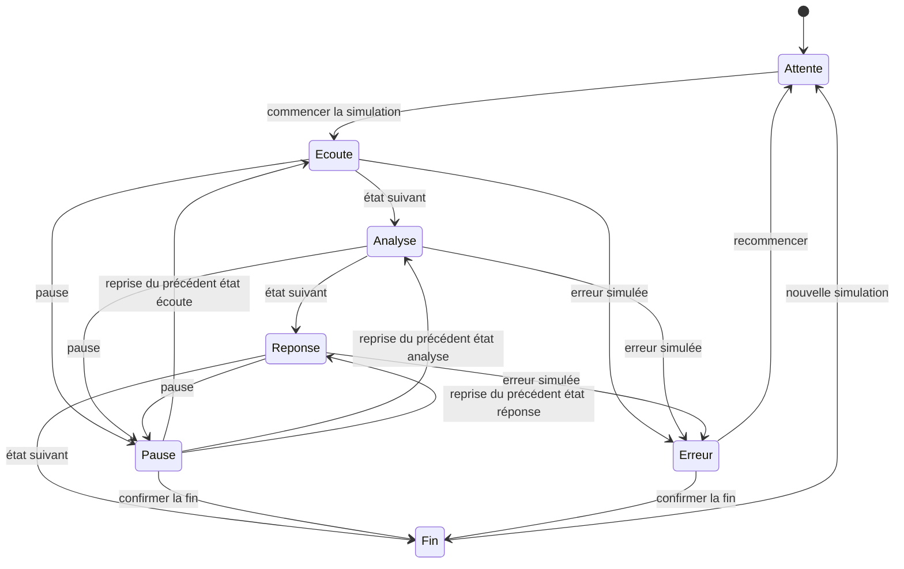

# Fluentia Voice — sphère et contrat d’interaction

Responsable : Jonathan Kakesa. Spécification de conception ; sept états simulés localement. Aucune capture audio, analyse ou réponse vocale réelle.

## États, messages et commandes

| État | Visuel | Message accessible | Commandes | Microphone / son dans le prototype |
|---|---|---|---|---|
| En attente | Sphère nuit, halo cyan fixe | En attente ; commencer quand prêt | Commencer, examiner un état | Inactif ; aucun son |
| Écoute | Respiration légère, échelle 1–1,025 | Écoute simulée ; microphone inactif | État suivant, pause, fin | Inactif ; aucun son |
| Analyse | Anneau lent, aucune progression chiffrée inventée | Analyse simulée ; aucun traitement audio | État suivant, pause, erreur, fin | Inactif ; aucun son |
| Réponse vocale | Respiration à rythme distinct | Réponse simulée et texte visible | État suivant, pause, fin | Inactif ; texte prédéfini, aucun son |
| Erreur | Halo remplacé par contour d’erreur et message | Un contretemps simulé ; refus de permission illustré | Recommencer via sélecteur/état suivant, fin | Aucune permission demandée |
| Pause | Saturation réduite, aucune pulsation | Séance en pause | Reprendre le dernier état, fin | Inactif |
| Fin | Sphère fixe, accès au rapport | Séance terminée ; rapport fictif | Recommencer, rapport | Inactif ; rien à effacer côté serveur |

Les textes et commandes portent la signification de l’état ; la couleur n’est pas le seul indice. La sphère décorative porte aria-hidden, l’état textuel est une région live polie. Les changements d’état conservent le focus sur la commande ; le sélecteur d’état est un outil de revue. Aucun timer n’annonce une seconde à la fois aux technologies d’assistance.

## Storyboard visuel

1. T0 : sphère de 250 px desktop, 190 px mobile ; dégradé radial cyan, bleu, nuit. Le logo reste un asset officiel indépendant, jamais redessiné par la sphère.
2. T0–180 ms : le message change immédiatement ; le halo rejoint l’état cible sans flash ni changement de mise en page.
3. Écoute : pulsation 2 s ; analyse : anneau 3 s ; réponse : pulsation 1,2 s. Le prototype emploie des animations CSS simples et non une scène 3D.
4. Pause ou erreur : les mouvements s’arrêtent immédiatement ; un texte confirme l’état et une action permet de poursuivre ou de terminer.
5. Fin : confirmation explicite, puis rapport fictif. Aucun score dérivé d’un audio inexistant.

Avec prefers-reduced-motion, toutes les animations et transitions sont supprimées ; formes, messages et commandes suffisent. La version mobile ne dépend ni du survol ni d’un déplacement du pointeur.

## Contrat futur de capture réelle — non implémenté

Un futur studio devra distinguer permission non demandée, en cours, accordée et refusée ; demander l’accès seulement après une action éclairée ; arrêter les pistes à la pause, à la fin et au changement de route ; indiquer la conservation, la finalité et la suppression avant toute transmission. Reprise de connexion, délai d’analyse, annulation et échec de lecture doivent être testés avec l’API réelle.

Le serveur devra imposer droits, durée et état de session. Une visualisation d’amplitude devra être alimentée par une mesure réelle et lissée, sans analyser le sens du propos à partir de la forme de la sphère. Les mécanismes exacts de conservation et d’évaluation restent à décider avec le propriétaire et les responsables compétents.
